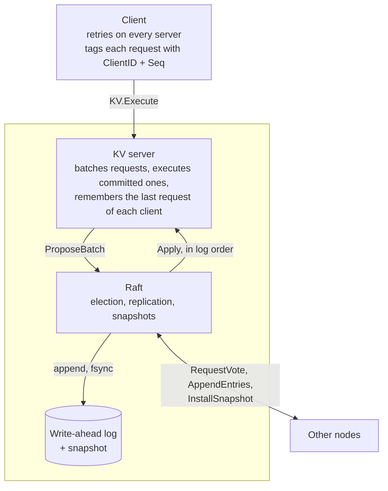

# raftkv

A distributed key-value store that stays correct and available when some of
its servers crash or lose contact with each other. It replicates every
operation with the [Raft consensus algorithm](https://raft.github.io/raft.pdf),
implemented here from scratch in Go using only the standard library.

- **Raft**: leader election, log replication, crash recovery from a
  write-ahead log, log compaction with snapshots, and InstallSnapshot.
- **Key-value service**: linearizable `Get`, `Put` and `Append`, with
  exactly-once semantics when clients retry.
- **Fault injection**: a simulated network that drops, delays, reorders and
  duplicates messages and partitions nodes, driven by a seed.
- **Verification**: chaos tests whose recorded histories are checked for
  linearizability with [Porcupine](https://github.com/anishathalye/porcupine).
- **Benchmarks**: throughput, latency and failover time for 3, 5 and 7 nodes.

The only dependency outside the standard library is Porcupine, and only the
tests use it.

| | Measured |
|---|---|
| Correctness | 106,457 operations across five fault scenarios, every history linearizable |
| Throughput | 10,925 operations per second on 3 nodes with 64 clients and fsync on (p50 5.5 ms, p99 17.6 ms) |
| Failover | a client can write again a median of 189 to 205 ms after the leader is killed |

All of it on one laptop; see [Benchmarks](#benchmarks) for what that does and
does not show.

## Architecture



The shaded box is one node; a cluster has 3, 5 or 7 of them.

Raft and the KV server only know a `Transport` interface. Two things
implement it:

| Transport | Used for | What it is |
|---|---|---|
| `simnet` | tests | In-memory network with injectable faults |
| `rpcnet` | real clusters, benchmarks | `net/rpc` over TCP |

The same Raft code runs over both, and one shared test suite
(`transport/transporttest`) holds both to the same behaviour.

### Repository layout

| Path | Contents |
|---|---|
| `raft/` | The consensus algorithm: `election.go`, `replication.go`, `snapshot.go`, `raft.go` (state, persistence) |
| `kv/` | State machine, server and client |
| `storage/` | Write-ahead log and snapshot files; an in-memory version for tests |
| `transport/` | `Transport` interface, typed RPC helpers, `simnet`, `rpcnet` |
| `chaos/` | Fault-injection tests with linearizability checking |
| `internal/cluster/` | Runs a whole cluster in one process, for tests and benchmarks |
| `internal/hrtime/` | High-resolution clock for measurements |
| `cmd/` | `raftkv-server`, `raftkv-cli`, `raftkv-bench` |
| `docs/` | Review questions about the design, with pointers into the code |

## Running it

Requires Go 1.22 or newer; developed and tested with Go 1.27.

```bash
go build -o bin/ ./cmd/...
```

Start three nodes, each in its own terminal:

```bash
bin/raftkv-server -id n1 -cluster n1=127.0.0.1:7001,n2=127.0.0.1:7002,n3=127.0.0.1:7003 -data data/n1
```

```bash
bin/raftkv-server -id n2 -cluster n1=127.0.0.1:7001,n2=127.0.0.1:7002,n3=127.0.0.1:7003 -data data/n2
```

```bash
bin/raftkv-server -id n3 -cluster n1=127.0.0.1:7001,n2=127.0.0.1:7002,n3=127.0.0.1:7003 -data data/n3
```

Then talk to the cluster:

```bash
bin/raftkv-cli -cluster n1=127.0.0.1:7001,n2=127.0.0.1:7002,n3=127.0.0.1:7003 put greeting hello
```

```bash
bin/raftkv-cli -cluster n1=127.0.0.1:7001,n2=127.0.0.1:7002,n3=127.0.0.1:7003 get greeting
```

Stop any one server and the commands keep working. Stop two and they hang
until one comes back: a majority is required. Restart a server and it
recovers its state from `data/`.

## Testing

```bash
go test ./...
```

| Suite | What it checks |
|---|---|
| `raft/` | Election safety, re-election, agreement, a minority leader that cannot commit, recovery after full restart, catch-up by snapshot, and random crashes on a lossy network |
| `kv/` | Operations, concurrent appends, exactly-once on a lossy network, failover, no stale reads from an isolated leader, the same over real TCP with files on disk |
| `chaos/` | Linearizability under leader kills, partitions, message loss, and all of them together |
| `storage/` | Round trips, reopening, a torn final record, a corrupt snapshot |
| `transport/` | Each fault type of the simulator, and the shared suite for both transports |

### Chaos tests

Each scenario runs a cluster for a few seconds while a nemesis injects faults
and seven clients issue random operations on three keys. Every operation is
recorded with its start and end time. Afterwards Porcupine searches for an
order of all operations that respects real time and that a single correct map
could have produced. If none exists, the test fails and writes an HTML
visualisation of the history.

```bash
go test ./chaos/ -v
```

```bash
go test ./chaos/ -v -chaos.duration=60s -chaos.seed=7
```

One run with `-chaos.duration=30s -chaos.seed=7` checked 106,457 operations
and found every history linearizable:

| Scenario | Nodes | Faults injected | Operations checked |
|---|--:|---|--:|
| Baseline | 3 | none | 42,962 |
| Kill leader | 3 | leader crashed and restarted, repeatedly | 30,710 |
| Partitions | 5 | random splits; half of them isolate the leader | 28,918 |
| Message loss | 3 | 5% of messages dropped, 5% duplicated, delays and reordering | 2,846 |
| Everything | 5 | message loss, partitions and random crashes together | 1,021 |

The lossy scenarios complete far fewer operations because each lost message
costs a client or an RPC a full timeout. That is a throughput weakness under
heavy loss, not a correctness one.

Passing these tests is evidence, not proof: they sample some interleavings
out of astronomically many.

### Checking the checker

A linearizability test that never fails proves little unless it can fail. Two
bugs were planted on purpose to find out:

| Planted bug | Scenario | Result |
|---|---|---|
| Duplicate detection disabled, so a retried Append runs twice | message loss | Reported as not linearizable |
| Leader answers Gets from its local map instead of the log | partitions | **Not detected at first**; reported as not linearizable after the workload was fixed |

The second row was a flaw in the test, not in the checker. A client that
writes notices a deposed leader as soon as one write stalls, and moves to the
new leader, so no client kept talking to the isolated leader for long enough
to see stale data. Two of the seven clients now only read, which keeps them
on the old leader and exposes the bug.

## Benchmarks

```bash
go run ./cmd/raftkv-bench -out bench/results
```

The benchmark starts a full cluster in one process. Every node has its own
TCP listener on 127.0.0.1 and its own directory of fsynced files, so the
numbers include real sockets, serialisation and disk syncs. They do not
include network latency, and all nodes share one machine's CPU and disk:
**on separate machines, latency would be higher and the cost of adding nodes
would look different.**


### Throughput and latency

| Nodes | Clients | Throughput (ops/s) | p50 (ms) | p99 (ms) |
|------:|--------:|-------------------:|---------:|---------:|
| 3 | 1 | 1,044 | 0.88 | 1.96 |
| 3 | 4 | 2,151 | 1.73 | 5.30 |
| 3 | 16 | 3,956 | 3.95 | 9.38 |
| 3 | 64 | 10,925 | 5.49 | 17.6 |
| 5 | 1 | 844 | 1.09 | 2.30 |
| 5 | 4 | 2,007 | 1.83 | 5.84 |
| 5 | 16 | 3,687 | 4.09 | 11.2 |
| 5 | 64 | 9,125 | 6.58 | 16.8 |
| 7 | 1 | 817 | 1.14 | 2.23 |
| 7 | 4 | 1,825 | 2.03 | 4.97 |
| 7 | 16 | 3,526 | 4.28 | 9.74 |
| 7 | 64 | 8,122 | 7.36 | 24.7 |

- **Throughput grows with the number of clients** because of group commit:
  requests that arrive while a batch is being synced to disk share the next
  sync. Three nodes go from 1,044 operations per second with one client to
  10,925 with 64.
- **A single request takes about a millisecond.** That is two disk syncs in
  sequence, the leader's and then a follower's, plus loopback round trips.
- **Bigger clusters are slower under load.** At 64 clients, 7 nodes handle
  about a quarter fewer operations than 3. Part of that is real (the leader
  serialises and sends every entry to more followers) and part is an artefact
  of every node sharing one CPU and one disk.

### Leader failover

The leader is killed while one client writes continuously. "New leader
elected" is the time from the kill until another node is leader. "Client can
write again" is the longest that client waited for a write to succeed.

| Nodes | Crashes | New leader elected: median (ms) | min | max | Client can write again: median (ms) | min | max |
|------:|--------:|--------------------------------:|----:|----:|------------------------------------:|----:|----:|
| 3 | 15 | 193 | 182 | 521 | 205 | 191 | 533 |
| 5 | 15 | 180 | 164 | 411 | 189 | 174 | 427 |
| 7 | 15 | 189 | 173 | 228 | 201 | 184 | 241 |

- **Recovery takes about one election timeout.** Followers wait 150 to 300 ms
  without a heartbeat before standing for election, and the median falls
  inside that range. Lowering the timeout would speed recovery and make
  spurious elections more likely.
- **The slow cases are elections that needed a second round**, when two
  candidates split the vote and both had to time out again.
- **The client follows about 12 ms behind the election.**

### How these were measured

- Machine: Microsoft Surface Laptop 7 (Snapdragon X Elite X1E-80-100, 12
  cores, 16 GB RAM, NVMe SSD), Windows 11 ARM64
- Go 1.27.2, measured 2026-10-12
- Transport: `net/rpc` over TCP on 127.0.0.1, all nodes in one process
- Storage: one directory per node on the same disk, fsync on
- Workload: 50% Put, 50% Get, uniform over 1,000 keys, 64-byte values, closed
  loop (each client sends its next request when the previous one is answered)
- Each data point: 2 s warm-up, then 8 s measured, one run
- Raft: election timeout 150-300 ms, heartbeat 50 ms, snapshot every 10,000
  entries

The raw numbers, including every failover trial, are in
[`bench/results/results.json`](bench/results/results.json).

## Problems the tests and benchmarks found

Four things were wrong or slow in earlier versions and only showed up when
measured:

1. **Persistence was an order of magnitude too slow**, which led to the
   write-ahead log (see [Persistence](#persistence)).
2. **Latencies under a millisecond read as zero**, because of the Windows
   clock (see [Measurement](#measurement)).
3. **One lost message could trigger an election.** Heartbeats waited for the
   outstanding replication request, so a dropped request left a follower
   without contact for longer than its election timeout. Heartbeats are now
   sent independently.
4. **Two of 45 failovers took a full second for the client** although a new
   leader existed within 300 ms. The new leader was a node that had just
   restarted, the client's cached connection to it was dead, and the client
   then avoided it as "unreachable". The transport now reconnects once when
   it finds a cached connection already closed; the longest client outage in
   the final run was 533 ms.

## Design decisions

### Simulated network

- **Faults are injected per message, and a request and its reply are separate
  messages.** A lost reply means the handler ran but the caller cannot know.
  This is the case that makes duplicate detection necessary, and the simulator
  produces it constantly.
- **Links are cut per direction.** A one-way cut lets a node keep receiving
  heartbeats while its own messages vanish, which group-based partitions
  cannot express.
- **Every fault decision comes from one seeded generator, but delays use real
  time and handlers run on real goroutines.** A seed reproduces the fault
  pattern, not the thread interleaving. Full determinism would need Raft
  written as a single-threaded state machine driven by a virtual clock; that
  was judged too large a constraint for this project.
- **Payloads are serialised and copied** even though everything is in one
  process, so two nodes can never share memory by accident.

### Raft

- **One mutex per node, never held across an RPC.** Each reply is checked
  against the term the request was sent in, because anything may have changed
  while the lock was released.
- **One replication goroutine per follower at a time.** Replies are therefore
  processed in the order requests were sent, and entries proposed meanwhile
  go out in the next request as a batch.
- **Heartbeats do not wait for that goroutine.** If a replication request is
  still outstanding when the heartbeat timer fires, a separate empty
  AppendEntries goes out. Otherwise one lost message would silence the leader
  for a whole RPC timeout, long enough for the follower to call an election.
- **A follower that rejects AppendEntries reports the conflicting term and its
  first index**, so the leader skips a whole term per round trip instead of
  one entry (the optimisation sketched at the end of §5.3).
- **A new leader appends a no-op entry.** A leader may only commit entries of
  its own term by counting replicas (§5.4.2, Figure 8); the no-op gives it one
  immediately, which commits everything before it.
- **Only one goroutine touches the state machine.** It applies entries, takes
  snapshots, and installs snapshots received from the leader, so those can
  never interleave.

### Persistence

- **Write-ahead log.** Each change to the term, the vote or the log is
  appended as one checksummed record and fsynced before the node replies. A
  record cut short by a crash fails its checksum on restart and is dropped;
  it was never acknowledged.
- **The first version rewrote a whole state file on every change** and renamed
  it into place. It was correct but slow: every write cost time proportional
  to the log, and on Windows the virus scanner briefly locks each new file,
  which made the rename fail and retry. In 2-second test runs on 3 nodes with
  16 clients, replacing it with the write-ahead log took throughput from 270
  to 3,308 operations per second and median latency from about 52 ms to
  about 4 ms.
- **Compaction writes the snapshot first, then rewrites the log.** A crash in
  between leaves a snapshot newer than the log, which the node repairs on
  start by discarding the prefix the snapshot covers. The opposite order
  could leave a log that starts after a snapshot that was never written.

### Key-value service

- **Reads go through the log.** This is the simplest way to guarantee a Get
  never returns stale data: a deposed leader cannot commit, so it cannot
  answer. The cost is a disk sync per read.
- **Exactly-once.** Each client numbers its requests. The state machine keeps
  the last request number and result per client, and answers a repeat from
  that table instead of executing it again. The table is part of the
  snapshot, otherwise a node restored from one would forget.
- **Group commit.** Requests queue while the previous batch is being written
  to disk, then go to Raft together with a single sync. This is why
  throughput rises with the number of clients.

### Measurement

- **Go's clock on Windows only advances on the timer tick**, roughly every
  half millisecond, which made sub-millisecond latencies read as zero. The
  benchmark and the chaos tests read the performance counter instead
  (`internal/hrtime`).

## Known limitations

- **Fixed membership.** Nodes cannot be added or removed without restarting
  the cluster (§6 of the paper is not implemented).
- **No PreVote or CheckQuorum.** A node returning from a partition has a
  higher term and forces one unnecessary election. A leader cut off from the
  majority keeps believing it leads; it cannot commit anything, so this is
  safe, but its clients wait for a timeout before trying elsewhere.
- **Reads are as expensive as writes.** ReadIndex or leader leases (§8) would
  avoid the log for reads.
- **Snapshots are whole and blocking.** The state is serialised in full, sent
  in a single RPC, held in memory, and written while the node's lock is held.
  This is fine for megabytes, not for gigabytes.
- **The session table never shrinks.** Clients that go away are remembered
  forever.
- **No authentication or encryption** between nodes or from clients.
- **Benchmarks ran on one laptop**, as described above.
- **The race detector only runs in CI.** It is not available on the Windows
  ARM64 machine used for development, so `go test -race` runs on Linux in the
  GitHub Actions workflow.

## References

- Diego Ongaro and John Ousterhout, *In Search of an Understandable Consensus
  Algorithm (Extended Version)*, 2014. Section numbers in code comments refer
  to this paper.
- Diego Ongaro, *Consensus: Bridging Theory and Practice*, PhD thesis, 2014.
- Anish Athalye, [Porcupine](https://github.com/anishathalye/porcupine), a
  linearizability checker.

## License

MIT. See [LICENSE](LICENSE).
